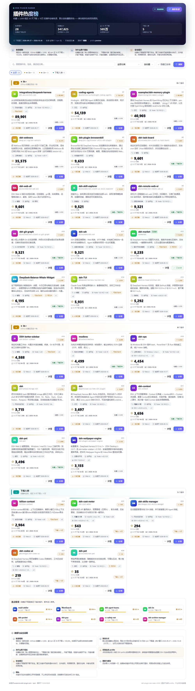

# Plugin Star Radar · dsh-plugin-star-radar

A "what should I install?" reference for people new to DeepSeek Harness (DSH).

It answers one question: **which DSH plugins are people actually paying attention to and installing?**

- Ranked by **GitHub stars**;
- Every card also shows **npm downloads over the last 30 days**, and you can re-sort by that;
- **3000+ stars OR 100k+ downloads in 30 days** gets a plugin **listed**;
- Once listed, a plugin **stays listed** even after it falls below both thresholds: it moves to a labelled `已跌出 · 保留` group for `retainDays` (180 by default) with its last measured numbers, so it is still findable months later.



## Why two metrics

| Downloads only | Stars only | Both |
| --- | --- | --- |
| Older plugins get pushed out by newer download spikes and become hard to find | A brand-new plugin that is installed in bulk but not starred yet is missed | What people keep watching *and* what gets installed right now |

Inclusion is the **union**; ranking is stars-first. A plugin that cools down stays on the page, which is exactly what a reference list needs.

## Install

### Desktop (recommended)

Settings → Plugins → Install, then paste:

```
dsh-plugin-star-radar
```

Or press the **安装 / Install** button on any card in this plugin.

### CLI

```bash
dsh plugin --profile web add dsh-plugin-star-radar
```

### Local checkout

```bash
pnpm add "file:D:/path/to/dsh-plugin-star-radar"
```

Add `"dsh-plugin-star-radar"` to `dsh.profile.bundles` in the profile's `package.json`, then restart DSH.

> Migrating from the older `dsh-plugin-radar` / `dsh-plugin-download-radar`? Disable and remove the old one first — all three register the same section id (`plugin-radar`), so only one may be enabled.

## What the page does

- **Groups** by star band (★ 5k+ / ★ 3k+ / download-only) so the tiers are obvious at a glance;
- **Search** across name, package, description and category;
- **Category filter** from the market index;
- **Sort** by stars / 30-day downloads / name;
- **Details** per card: stars, downloads, why it is listed, listing date, Node/DSH ranges, OS/CPU, package size, permission notes, manual install command, repo links;
- **One-click install** through the official `pluginManager.installBundle`, falling back to the profile's pnpm with a copyable manual command.

## Configuration

In the profile's `cordis.patch.yml`:

```yaml
- id: plugin-radar
  config:
    minStars: 3000
    minDownloads: 100000
    intervalHours: 6
```

| Key | Default | Meaning |
| --- | --- | --- |
| `minStars` | `3000` | star count that gets a plugin listed |
| `minDownloads` | `100000` | 30-day download count that gets a plugin listed |
| `retainDays` | `180` | days a plugin stays visible after falling below both thresholds |
| `intervalHours` | `6` | background refresh interval (1–168) |
| `catalogTtlHours` | `12` | market index cache |
| `metaTtlHours` | `24` | npm manifest cache |
| `maxManifest` | `80` | how many manifests feed the environment notes |
| `manifestBudgetMs` | `90000` | manifest phase budget; overruns are skipped, never block the board |
| `catalogUrl` / `npmRegistry` | official | point them at a mirror if needed |
| `dataDir` | `<profile>/.dsh-plugin-radar` | cache directory |

## Where the data comes from

| Data | Source |
| --- | --- |
| plugin list, GitHub stars, 30-day downloads, category, description, icon | `https://awesome-dsh-plugin.com/plugins.json` — **one** request for everything |
| Node/DSH ranges, `os`/`cpu`, install scripts, package size | `https://registry.npmjs.org/<pkg>/latest`, only for listed plugins |

Two deliberate choices:

1. **No per-package npm downloads history calls.** `api.npmjs.org/downloads/range` answers HTTP 429 under bursts, which is what made an earlier version of this plugin stall mid-refresh. One catalog request cannot rate-limit itself.
2. **Manifest reads are optional and budgeted.** Missing notes never block the board.

## Development

```bash
node scripts/build-client.mjs      # client.css + client.src.js -> client.js
node --test "test/*.test.mjs"      # offline unit tests
node scripts/live-check.mjs        # real market index, prints the board

cd preview && npm install && npm run build && npm run serve
npm run shot                       # screenshots into preview/screenshots/
```

## Publishing

There is no official DSH marketplace; community indexes fill the gap. See [docs/publishing.md](./docs/publishing.md).

## License

MIT
