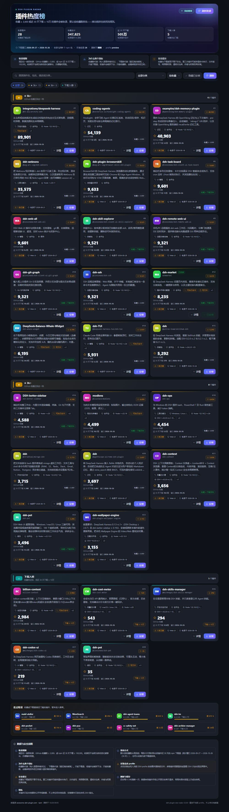
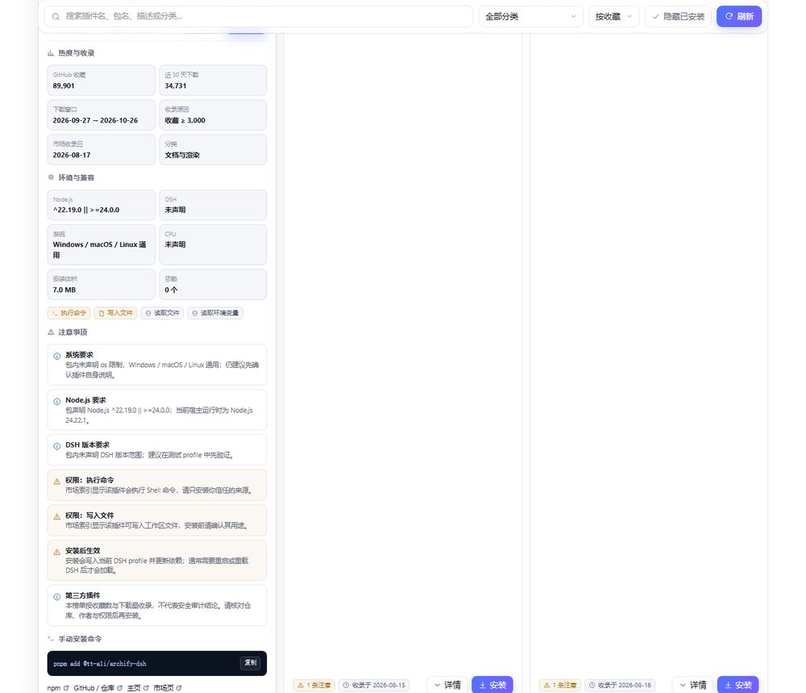

# 插件热度榜 · dsh-plugin-star-radar

给刚玩 DeepSeek Harness（DSH）的人一张「该装什么」的参考表。

它只回答一个问题：**大家在关注、在安装的 DSH 插件，是哪些？**

- 榜单按 **GitHub 收藏数（stars）** 排名；
- 每张卡片同时给出 **近 30 天 npm 下载量**，也能切换成按下载量排序；
- **收藏 ≥ 3,000 或近 30 天下载 ≥ 10 万**，满足任一条就会被**收录**；
- 收录之后不会因为排名掉下去而消失；即使两个指标**同时跌破门槛**，它还会以「已跌出 · 保留」的身份**继续留在列表里 180 天**（可用 `retainDays` 调整），可以随时回查——这是它和普通排行榜最大的区别。




<details>
<summary>卡片详情（环境要求 / 权限提示 / 手动安装命令）</summary>



</details>

> 截图由仓库内 `preview/` 渲染真实 `lib/client.js` + 真实市场快照生成。

## 为什么是「收藏 + 下载」两个指标

| 只看下载量 | 只看收藏数 | 两个一起 |
| --- | --- | --- |
| 老插件会被新插件的下载高峰挤下去，过几天就找不到了 | 刚发布就爆火的新插件（比如被大量自动安装）会被漏掉 | 谁在持续被关注、谁最近真被装，都能看见 |

所以收录是**并集**，排名以收藏为主。这样即便某个插件后来热度下滑、被挤出前排，它依然在这张表里，随时找得到——这正是「给新手做参考」需要的行为，而不是又做一个每小时都在洗牌的排行榜。

## 界面

两个入口，内容一致：

1. **设置 → 热度榜**（`settings.section`，顺序 46）
2. **设置 → 插件 → 热度榜 Tab**（`plugins.tab`）

页面能力：

- **分组**：按收藏档位分区（★ 5k+ / ★ 3k+ / 下载入榜），一眼看出体量层级；
- **搜索**：插件名、包名、描述、分类都能搜；
- **分类筛选**：UI / 工具 / 记忆 / 主题……按市场分类过滤；
- **排序**：按收藏（默认）/ 按近 30 天下载 / 按名称；
- **详情**：收藏、下载、收录原因、收录日期、Node/DSH 版本要求、系统与 CPU、安装体积、权限提示、手动安装命令、仓库链接；
- **一键安装**：走官方 `pluginManager.installBundle`，失败时回落到 profile 自带的 pnpm，并给出可复制的手动命令。

## 安装

### 方式一：桌面端插件页（推荐）

DSH Desktop → **设置 → 插件 → 安装**，粘贴包名：

```
dsh-plugin-star-radar
```

或者直接在本页点「安装」按钮。

### 方式二：CLI

```bash
dsh plugin --profile web add dsh-plugin-star-radar
```

`web` 换成你自己的 profile 名；查看当前 profile：`echo $DSH_PROFILE`（Windows PowerShell: `$env:DSH_PROFILE`）。

### 方式三：本地目录（开发 / 自用）

在 profile 目录执行：

```bash
pnpm add "file:D:/path/to/dsh-plugin-star-radar"
```

然后在 profile 的 `package.json` 里把它加入 bundles，并重启：

```json
{
  "dsh": { "profile": { "bundles": ["dsh-plugin-star-radar"] } }
}
```

### 从旧包名迁移

如果你装过早期的 `dsh-plugin-radar` 或 `dsh-plugin-download-radar`：

1. 先在「设置 → 插件」里停用并卸载旧的那一个；
2. 再按上面的方式安装 `dsh-plugin-star-radar`；
3. 重启 DSH。

三个包都注册同一个入口 id（`plugin-radar`），**不要同时启用**，否则两个页面会抢同一个设置分区。

安装后如果看不到入口：确认插件是启用状态，然后重启 DSH（宿主端代码改动必须重启才会重新加载）。

## 配置（可选）

在 profile 的 `cordis.patch.yml` 里改：

```yaml
- id: plugin-radar
  config:
    minStars: 3000        # 收藏门槛
    minDownloads: 100000  # 近 30 天下载门槛
    intervalHours: 6      # 后台刷新间隔（1–168）
    maxManifest: 80       # 最多读取多少个包的 npm manifest（用于环境提示）
```

| 字段 | 默认 | 说明 |
| --- | --- | --- |
| `minStars` | `3000` | GitHub stars 达到这个数就收录 |
| `minDownloads` | `100000` | 近 30 天 npm 下载达到这个数就收录 |
| `retainDays` | `180` | 跌出门槛后仍保留展示的天数（1–3650） |
| `intervalHours` | `6` | 后台刷新间隔，1–168 小时 |
| `catalogTtlHours` | `12` | 市场索引缓存时间 |
| `metaTtlHours` | `24` | npm manifest 缓存时间 |
| `maxManifest` | `80` | 单轮最多读多少个 manifest（只为环境提示服务） |
| `manifestConcurrency` | `4` | manifest 并发数 |
| `manifestBudgetMs` | `90000` | manifest 阶段的时间预算，超时就跳过，**不影响榜单** |
| `nearMissLimit` | `8` | 「差点收录」区域显示几条 |
| `catalogUrl` | 官方索引 | 可换镜像 |
| `npmRegistry` | `https://registry.npmjs.org` | 可换镜像（国内可用 npmmirror） |
| `dataDir` | `<profile>/.dsh-plugin-radar` | 缓存目录 |

改阈值后刷新一次页面即可生效，不需要重装。

## 数据从哪里来

| 数据 | 来源 | 说明 |
| --- | --- | --- |
| 插件清单、GitHub stars、30 天下载量、分类、描述、图标 | `https://awesome-dsh-plugin.com/plugins.json` | 社区维护的插件索引，**一次请求**拿全量 |
| Node/DSH 版本、`os`/`cpu`、安装脚本、体积 | `https://registry.npmjs.org/<pkg>/latest` | 只对被收录的插件读取，用于卡片上的环境提示 |

设计上有两条刻意的取舍：

1. **不调用 npm 的逐包下载历史接口**。`api.npmjs.org/downloads/range` 对连续请求会返回 429，是这个插件早期版本「刷新卡住」的根因。现在整张榜单只依赖一次索引请求，天然不会被限流。
2. **manifest 读取是可选的、有预算的**。读到了就显示环境提示，读不到或超时就只少一段提示，榜单照常出。

缓存都在当前 profile 的 `.dsh-plugin-radar/` 下：`snapshot.json`、`catalog-cache.json`、`meta-cache.json`。删掉这三个文件就会全量重来。

## 常见问题

**为什么只有二三十个插件？**
门槛就是这么定的：收藏 ≥ 3,000 或近 30 天下载 ≥ 10 万。想看得更多就把 `minStars` 调低（比如 1000 会变成 40 多个），页面会长一些。

**跌出榜单的插件会消失吗？**
不会。只要它曾经达标过，就会以「已跌出 · 保留」出现在列表最下方的独立分组里，并保留最后一次测到的收藏/下载数；重新达标后自动回到正常分组。超过 `retainDays`（默认 180 天）才会真正移除，避免名单无限增长。

**我常装的插件为什么不在榜上？**
它可能两个指标都没到门槛——这时的正确做法不是放宽榜单，而是去给它点个 star。也可以直接在搜索框里搜包名，看看它离门槛还差多少（页面底部的「差点收录」区就是干这个的）。

**为什么有的插件 star 很高、下载却只有几百？**
star 是长期积累，下载是近 30 天的即时热度。两者的时间尺度不同，所以卡片上并排放，不做加权。

**点安装没反应 / 报错？**
- 桌面端：优先走 `pluginManager`，若提示「另一个安装任务正在进行」，等当前任务结束；
- CLI 场景：会回落到 profile 的 pnpm，失败时弹窗里会给可复制的 `pnpm add` 命令；
- 安装完**需要重启或重载 DSH** 才会出现入口。

**数据多久更新一次？**
后台每 6 小时刷新；打开页面时如果数据过期，会在后台补一次。刷新失败保留上次成功快照，不会把榜单清空。

**安全吗？**
不承诺。榜单只统计公开的收藏与下载，**不代表安全审计**。插件可能申请命令执行、文件读写、网络等权限，安装前请看卡片上的权限提示与仓库。

## 开发

```bash
# 语法检查
node --check lib/index.js && node --check lib/client.js

# 重新构建浏览器端（client.css + client.src.js → client.js）
node scripts/build-client.mjs

# 单元测试（全部离线，不联网）
node --test "test/*.test.mjs"

# 真实网络冒烟：读取真市场索引，打印榜单（约 5–10 秒）
node scripts/live-check.mjs

# 本地预览 + 截图（需要 Edge/Chrome）
cd preview
npm install
npm run build
npm run serve     # http://127.0.0.1:64555
npm run shot      # 另开终端，输出 preview/screenshots/
```

### 目录结构

```
dsh-plugin-star-radar/
├── package.json          # 包清单：dsh.bundle / dsh.client / locale / icon
├── cordis.patch.yml      # 把宿主行插进 profile 的 patch
├── icon.svg
├── lib/
│   ├── index.js          # 宿主入口：HTTP API + 定时器
│   ├── service.js        # 缓存、刷新、安装
│   ├── fetcher.js        # 市场索引 / npm manifest
│   ├── core.js           # 收录规则、分组、注意事项、快照（纯函数）
│   ├── seeds.js          # 索引不可达时的内置种子
│   ├── client.src.js     # 浏览器端源码
│   ├── client.css        # 命名空间化样式（dpr- 前缀）
│   └── client.js         # 构建产物（DSH 实际加载）
├── locale/               # 插件列表里的显示名与描述
├── test/                 # 离线单元测试
├── preview/              # 本地渲染 + 截图工具（不随包发布）
└── docs/                 # README 截图与发布指南
```

## 发布到插件市场

没有官方市场，社区靠几个索引站。完整步骤见 [docs/publishing.md](./docs/publishing.md)，要点：

1. 发布到 npm（包名 `dsh-plugin-star-radar`）；
2. 向 [awesome-dsh-plugin](https://github.com/awesome-dsh-plugin/awesome-dsh-plugin) 提 PR，在 `data/plugins/` 加一个 `<owner>__<repo>.yml`；
3. （可选）提交到 [dshbase](https://dshbase.com/) 做安装实测。

## 许可证

MIT
